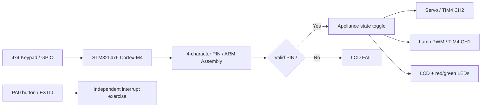

# STM32 Cortex-M4 Smart Home Controller

**Inha University · Embedded Systems Design · Team C · 2026**

A university hardware prototype built on the **STM32L476G Discovery (ARM Cortex-M4)** board, combining a matrix keypad, four-character PIN validation in **ARM Thumb Assembly**, a glass LCD, servo actuation, red/green status LEDs, and timer-based PWM control of a smart lamp. A separate Cortex-M4 exercise demonstrates external-interrupt (EXTI) button handling.

> **Original physical prototype:** the team reports that the hardware demonstration worked successfully. **Portfolio code:** includes original surviving artifacts plus an explicitly labeled reconstruction of the missing integrated application source. The reconstructed C code was not re-tested on the hardware and has not been rebuilt with the vendor SDK in this recovery environment.

## Key implementation

- Keypad scans 4x4 input through GPIO row/column signals; `*` clears and `#` confirms the entered PIN.
- The real ARM Assembly routine `asm_check_password` compares exactly four ASCII characters and returns a success flag to C.
- A correct demo PIN toggles the appliance state and actuates the servo using TIM4 CH2 on PB7.
- The LCD and LEDs display feedback; TIM4 CH1 on PB6 adjusts the lamp PWM duty.
- A separate `SmartHome_BlinkTest` project uses PA0 / EXTI0 and switches between red and green LEDs, including debounce handling.

## Architecture

## Project files

| Folder | Contents |
|---|---|
| `firmware/reconstructed/` | **Reconstructed** missing integrated C application plus recovered original password-check Assembly |
| `firmware/blink-test/` | Original standalone STM32CubeIDE PA0 interrupt/LED test project; retained linker and startup files |
| `docs/HARDWARE_AND_SOURCE_NOTES.md` | Actual recovered pin map, design-vs-implementation distinctions and test limitations |
| `docs/BUILDING.md` | Exact steps to integrate with STM32CubeL4 and run the standalone test project |
| `tests/` | Source-level and compiler checks not requiring hardware |

## Rebuilding the projects

**Standalone interrupt demo:** import the folder `firmware/blink-test` into STM32CubeIDE as an existing STM32 project, then build with your installed STM32 ARM toolchain. The uploaded archive includes a historical successful build artifact, but the current portable copy was only checked offline.

**Integrated application:** start from the official STM32CubeL4 `32L476GDISCOVERY/Examples/BSP` example with its full **Drivers / Inc / Src** dependencies. Replace its `Src/main.c` with the source in `firmware/reconstructed/main.c` and add `firmware/reconstructed/password_check.s` to the build. See [build instructions](docs/BUILDING.md). This reconstruction is designed around the recovered pin map, not claimed as a byte-for-byte recreation of `BSP.elf`.

## Proposal vs completed work

The proposal described an ultrasonic-triggered fan and stepper motor. The recoverable compiled firmware, however, establishes **servo + PWM lamp + keypad-controlled access**. The repository highlights what the provided binary and source artifacts actually show, rather than claiming the unrealized proposal components are present in the recovered code. See [implementation notes](docs/HARDWARE_AND_SOURCE_NOTES.md).

## Notes on use

This is a **classroom proof of concept**, not a production smart lock, certified security device, or commercial control system. The four-character `DEMO_PIN` is publicly visible in this repository. The `main.c` reconstruction masks keypad input and bounds its key-release wait, but those changes were **not hardware validated**. Motor/load drivers and a safe power supply are required.

## Credits

A collaborative Team C university project. Some original source files were missing from the provided archival ZIP files; these have not been misrepresented as intact originals. The README credits the team collectively without publishing personal student numbers. Individual contributions can be added only with approval.
